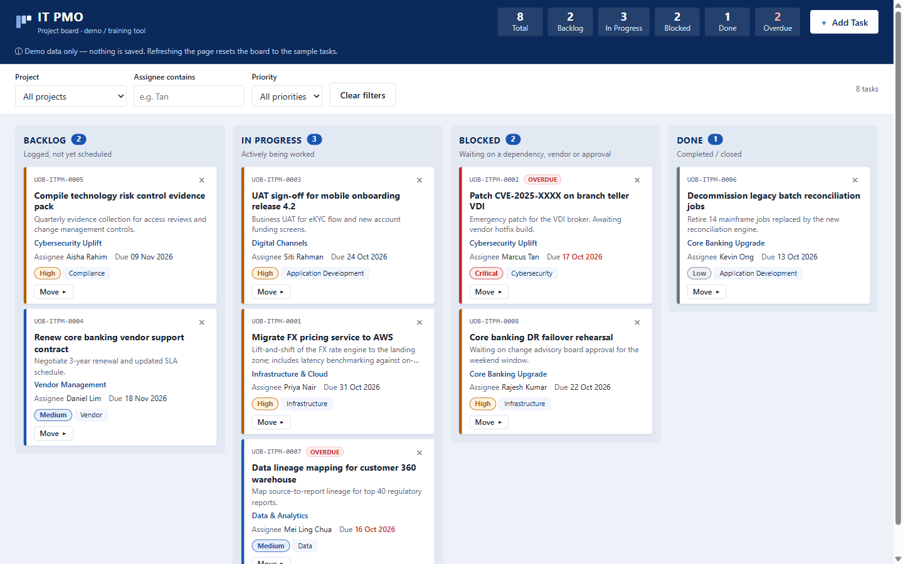
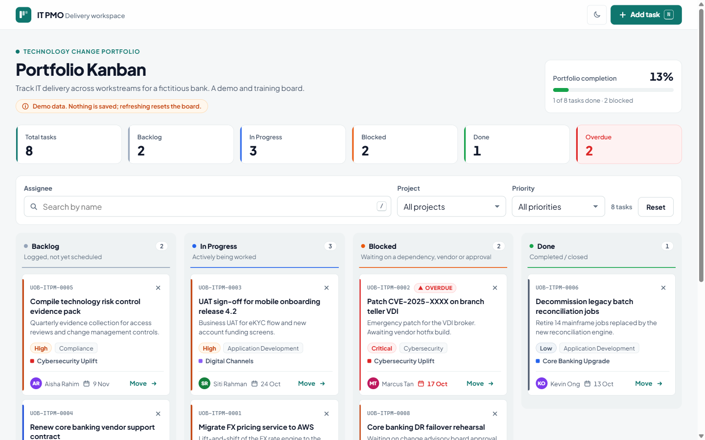

# IT PMO Kanban

A single-page Kanban board for tracking IT project-management-office tasks, built as a demo / training tool with plain HTML, CSS and JavaScript.


[](https://github.com/arjunramanjanappa/IT-training/actions/workflows/pages.yml)

**Live demo:** https://arjunramanjanappa.github.io/IT-training/



**Redesigned board (v2):** https://arjunramanjanappa.github.io/IT-training/v2/



**Design mock (v3):** https://arjunramanjanappa.github.io/IT-training/v3/

## Features

- Four columns: **Backlog**, **In Progress**, **Blocked** and **Done**, preloaded with sample IT tasks
- Header summary strip with task counts per status plus an **Overdue** count
- Drag and drop cards between columns, or use the per-card "Move to" menu (keyboard friendly)
- **Add Task** sidebar form with validation: title, description, project / workstream, category, assignee, priority, due date and status
- Client-side filters by project, assignee (text search) and priority, with a live result count
- Delete with inline confirmation, toast notifications and overdue badges
- Optional email notification for new tasks through [FormSubmit](https://formsubmit.co/) (off until you configure an address)
- Accessible markup: labelled regions, ARIA live regions, focus management, Escape to close panels
- No persistence: refreshing the page resets the board to the sample data

### v2 redesign

`v2/index.html` is a redesigned version of the same board, built with the [ui-ux-pro-max](https://github.com/nextlevelbuilder/ui-ux-pro-max-skill) skill's guidance for productivity tools. The original page is unchanged.

- Flat, light design with a teal palette and the Plus Jakarta Sans font
- Light and dark themes: follows your system setting, with a toggle that remembers your choice
- Keyboard shortcuts: **N** for a new task, **/** to search by assignee, **Esc** to close panels and menus
- Larger touch targets on phones and tablets, a skip-to-board link, and reduced motion when your system asks for it
- Same features and sample data as the original

### v3 design mock

`v3/index.html` is a visual concept built with the [high-end-visual-design](https://github.com/leonxlnx/taste-skill) skill: a dark, glassy one-page overview with a floating navigation bar, a full-screen menu, a dashboard of mixed-size summary cards and a drag-and-drop board. It is a mock, not a full replacement: it uses the same sample tasks but has no Add Task form, filters or email notifications. Dragging a card between lanes updates the summary cards.

## How to install

Prerequisites:

- Any modern browser (Chrome, Edge, Firefox, Safari)
- [Git](https://git-scm.com/) to clone the repo
- Optional: Python 3.x, to serve the page locally

```bash
git clone https://github.com/arjunramanjanappa/IT-training.git
cd IT-training
```

There are no dependencies to install and no build step.

## How to run

Open `index.html` directly in your browser, or serve the folder locally:

```bash
python -m http.server 8000
```

Then visit http://localhost:8000.

### Enabling email notifications (optional)

In `index.html`, set `FORMSUBMIT_ENDPOINT` to `https://formsubmit.co/ajax/<your-address>`. FormSubmit sends a one-time activation email to that address on the first submission; no notifications are delivered until you click the activation link.

## Deployment

Every push to `main` runs the [`pages.yml`](.github/workflows/pages.yml) GitHub Actions workflow. The **build** job checks that the site entry point exists and packages only the site files (`index.html`, `v2/index.html` and `v3/index.html`) as a Pages artifact; the **deploy** job then publishes that artifact to GitHub Pages using `actions/deploy-pages`. Pull requests run the build job only, without deploying, and the workflow can also be started manually from the Actions tab.

## Project structure

```
.
├── .github/
│   └── workflows/
│       └── pages.yml   # Build + deploy to GitHub Pages
├── docs/
│   ├── screenshot.png     # Screenshot of the original board
│   └── screenshot-v2.png  # Screenshot of the v2 redesign
├── .gitignore
├── index.html          # The whole app: markup, styles and script
├── v2/
│   └── index.html      # Redesigned version of the board
├── v3/
│   └── index.html      # Design mock (dark, glassy concept)
└── README.md
```
